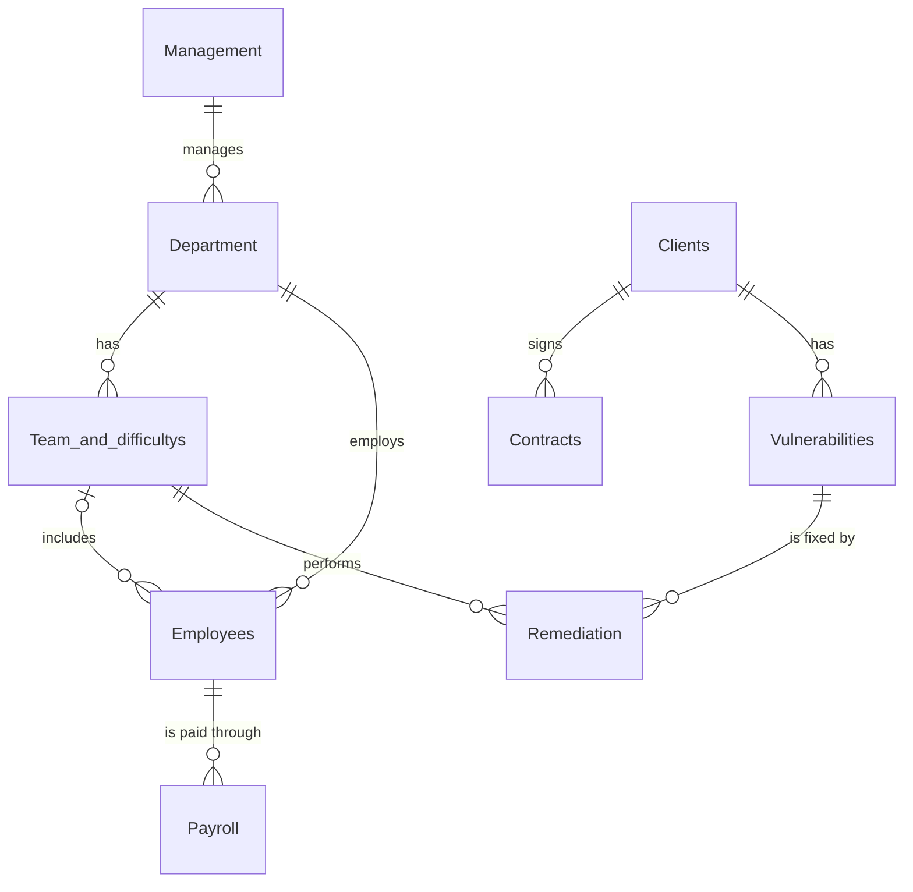

```markdown
# Salem Cybersecurity – Full-Stack Dashboard

A full-stack web application designed to visualize the **vulnerability remediation lifecycle** of a fictional cybersecurity company, Salem. 

This project bridges a relational **MySQL** database with a **Python (Flask)** backend and a dynamic **Vanilla JavaScript** frontend. It proves that complex data can be fetched, filtered, and rendered seamlessly without heavy frameworks.

> **Project type:** Academic / Personal Portfolio Project
> **Tech Stack:** Python (Flask), MySQL, HTML5, CSS3, Vanilla JavaScript
> **Author:** Ali Abdulrahman Alghamdi

---

## 📌 Project Overview

Cybersecurity companies need to track which team fixed which vulnerability, how severe it was, and what method was used. This dashboard provides a live, interactive view of that data.

**Key Features:**
- **Relational Database:** A fully normalized MySQL schema with 9 tables, foreign keys, and CHECK constraints.
- **REST API:** A lightweight Flask server that acts as a bridge, fetching data from MySQL and serving it as JSON.
- **Dynamic Frontend:** Uses JavaScript `fetch` API to pull data asynchronously.
- **Client-Side Filtering:** Users can instantly filter vulnerabilities by severity (Critical, High, Medium, Low) without reloading the page.
- **Responsive UI:** Clean, modern design with built-in Dark Mode support using CSS variables.

---

## 🗺️ Database Architecture

The backend is powered by a relational database (`Salem_Cybersecurity_Company`) containing **9 interlinked tables**. 



**Key SQL Feature:** To optimize dashboard performance, the `Team_and_difficultys` table is updated using an advanced `UPDATE + JOIN + Subquery` statement to pre-calculate vulnerability counts by severity for each team.

---

## 🛠️ Tech Stack

- **Backend:** Python 3, Flask, `mysql-connector-python`, `python-dotenv`
- **Database:** MySQL
- **Frontend:** HTML5, CSS3 (Flexbox/Grid, Dark Mode), Vanilla JavaScript (ES6, Fetch API)

---

## 📁 Repository Structure

```text
├── app.py                 # Flask server, API endpoints, and DB connection
├── Schema.sql             # Database creation, tables, and sample data
├── requirements.txt       # Python dependencies
├── .env.example           # Template for environment variables
├── README.md              # Project documentation
└── static/
    ├── index.html         # Frontend structure
    ├── style.css          # Styling and responsive design
    └── script.js          # Frontend logic (fetching and filtering)
```

---

## 🚀 How to Run Locally

Follow these steps to get the project running on your machine.

### 1. Database Setup
1. Open **MySQL Workbench** (or your preferred MySQL client).
2. Open the `Schema.sql` file provided in this repository.
3. Execute the entire script. This will automatically create the database, build the 9 tables, insert the sample data, and run the analytical queries.

### 2. Environment Variables Setup
1. Duplicate the `.env.example` file and rename the copy to `.env`.
2. Open `.env` and fill in your local MySQL credentials:
   ```env
   DB_HOST=localhost
   DB_USER=root
   DB_PASSWORD=your_mysql_password
   DB_NAME=Salem_Cybersecurity_Company
   ```

### 3. Backend Setup (Flask)
1. Open your terminal in the project directory.
2. Create and activate a virtual environment (optional but recommended):
   ```bash
   python -m venv venv
   source venv/bin/activate  # On Windows use: venv\Scripts\activate
   ```
3. Install the required dependencies:
   ```bash
   pip install -r requirements.txt
   ```
4. Start the Flask server:
   ```bash
   python app.py
   ```

### 4. Access the Dashboard
Open your web browser and navigate to:
```text
http://127.0.0.1:5000
```

---

## 🧠 What I Learned & Demonstrated

1. **Database Design:** Creating a 3NF relational database with complex relationships and data integrity constraints (`NOT NULL`, `CHECK`, `ENUM`).
2. **Advanced SQL:** Writing multi-table `JOIN` queries and using correlated subqueries to keep summary tables updated.
3. **Backend API Development:** Building secure RESTful endpoints using Flask and handling environment variables via `.env`.
4. **Asynchronous JavaScript:** Using the `fetch` API to request JSON data without reloading the page.
5. **DOM Manipulation:** Dynamically building HTML tables and implementing client-side filtering using array methods (`filter`, `map`).
6. **Modern CSS:** Implementing CSS Variables for theming and `prefers-color-scheme` for automatic Dark Mode.

---

## 👤 Author

**Ali Abdulrahman Alghamdi**
AI Diploma Student – Al-Baha University
📧 s86192565@gmail.com
