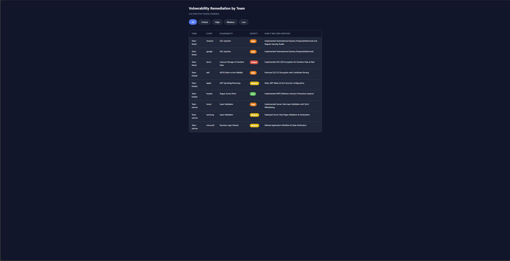
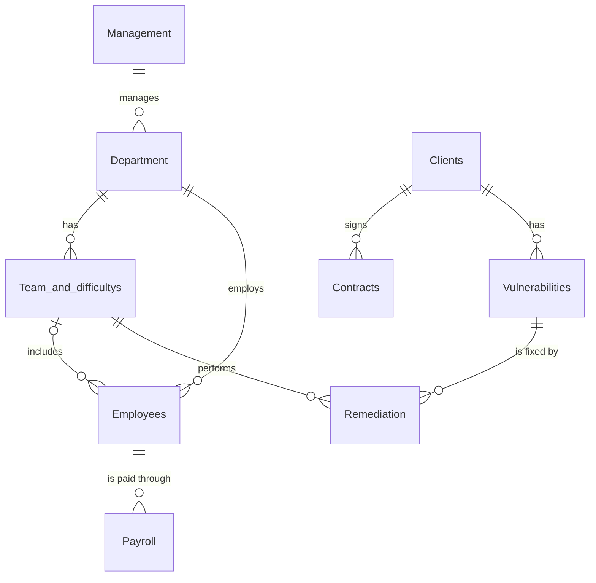

[README.md](https://github.com/user-attachments/files/34388989/README.md)
# Salem Cybersecurity – Full-Stack Dashboard

A small full-stack web application that shows the **vulnerability remediation lifecycle** of a fictional cybersecurity company, **Salem**: which vulnerability was found at which client, how severe it was, which team fixed it, and how.

The project connects a **MySQL** database to a **Python (Flask)** backend that serves JSON, and a **vanilla JavaScript** frontend that loads and filters the data in the browser, with no frontend frameworks.

> **Project type:** Academic / personal portfolio project
> **Tech stack:** Python (Flask), MySQL, HTML, CSS, JavaScript
> **Author:** Ali Abdulrahman Alghamdi – AI Diploma student, Al-Baha University



> **Note:** All data in this project (companies, employees, vulnerabilities, payroll, IDs) is fictional and used for demonstration only.

---

## 📌 Features

- **Relational database:** 9 related MySQL tables with primary/foreign keys and `NOT NULL`, `CHECK`, and `ENUM` constraints.
- **REST endpoint:** A Flask route that runs a multi-table `JOIN` query and returns the result as JSON.
- **Dynamic frontend:** JavaScript `fetch` loads the data asynchronously and builds the table without reloading the page.
- **Client-side filtering:** Filter vulnerabilities by severity (Critical, High, Medium, Low) with one click.
- **Responsive design with automatic dark/light mode:** CSS variables and `prefers-color-scheme`.
- **Credentials kept out of the code:** Database settings are loaded from a `.env` file that is not committed.

---

## 🧱 How It Works

```
Browser (HTML + CSS + JavaScript)
        │  fetch("/api/vulnerabilities")
        ▼
Flask server (app.py)
        │  SQL query (JOIN across 4 tables)
        ▼
MySQL database (Salem_Cybersecurity_Company)
```

1. The browser opens `/`, and Flask serves `static/index.html`.
2. `script.js` requests `/api/vulnerabilities`.
3. Flask connects to MySQL, runs the query, and returns the rows as JSON.
4. JavaScript renders the rows as a table and handles the severity filter buttons.

### API Endpoint

| Method | Route | Description |
|--------|-------|-------------|
| GET | `/` | Serves the dashboard page |
| GET | `/api/vulnerabilities` | Returns all vulnerabilities with their client, severity, fixing team, and fix method |

Example response (one item):

```json
{
  "client": "Amazon",
  "vulnerability": "SQL Injection",
  "severity": "High",
  "team": "Team fahed",
  "method": "Implemented Parameterized Queries (PreparedStatement) and Regular Security Audits"
}
```

The query behind it:

```sql
SELECT c.Company_Name AS client,
       v.Vuln_Name    AS vulnerability,
       v.Severity     AS severity,
       t.Team_Name    AS team,
       r.Fix_Method   AS method
FROM Vulnerabilities v
JOIN Clients c ON v.commercial_register_id = c.commercial_register_id
JOIN Remediation r ON v.Vuln_ID = r.Vuln_ID
JOIN Team_and_difficultys t ON r.Team_ID = t.Team_ID
ORDER BY t.Team_Name;
```

---

## 🗺️ Database Design

The database `Salem_Cybersecurity_Company` has **9 related tables**.



| Table | Purpose |
|-------|---------|
| `Management` | Company managers |
| `Department` | Departments (Network Security, Application Security, Data Security, Law, Accounting) |
| `Team_and_difficultys` | Technical teams, with stored counts of vulnerabilities by severity |
| `Clients` | Client companies and their industry |
| `Employees` | Employees, their department, and optional team |
| `Payroll` | Monthly salary records |
| `Contracts` | Contracts signed with clients |
| `Vulnerabilities` | Vulnerabilities found at clients (with an `ENUM` severity) |
| `Remediation` | How, when, and by which team each vulnerability was fixed |

### Constraints used

| Constraint | Example |
|-----------|---------|
| `PRIMARY KEY` / `FOREIGN KEY` | Every table; links such as `Remediation.Vuln_ID → Vulnerabilities` |
| `NOT NULL` | Names, dates, salaries, severity, fix method |
| `CHECK` | `Contracts`: `End_Date >= Start_Date` |
| `ENUM` | `Vulnerabilities.Severity`: `'Low'`, `'Medium'`, `'High'`, `'Critical'` |
| `AUTO_INCREMENT` | `Payroll.Payroll_ID` |
| `DECIMAL(10,2)` / `BIGINT` | Salaries; commercial register numbers |

### SQL concepts practiced

`SELECT`, `JOIN`, subqueries, `COUNT` / `SUM`, `ORDER BY`, `LIKE`, `UPDATE`.

A summary table of vulnerability counts per team (`Team_and_difficultys`) is maintained with an `UPDATE + JOIN + subquery` statement in `Schema.sql`. The dashboard itself reads vulnerability details directly through the `JOIN` query shown above.

---

## 📁 Repository Structure

```text
├── app.py              # Flask server, API route, and database connection
├── Schema.sql          # Database creation, tables, sample data, and queries
├── requirements.txt    # Python dependencies
├── .env.example        # Template for environment variables
├── dashboard.png       # Screenshot used in this README
└── static/
    ├── index.html      # Page structure
    ├── style.css       # Styling, responsive layout, dark mode
    └── script.js       # Fetching, rendering, and filtering
```

---

## 🚀 Run It Locally

**Requirements:** Python 3, MySQL, and MySQL Workbench (or any MySQL client).

### 1. Create the database
Open `Schema.sql` in MySQL Workbench and run the whole script. It creates the database, the 9 tables, and the sample data.

> ⚠️ The script starts with `DROP DATABASE IF EXISTS`, so it deletes any existing database with the same name.

### 2. Create a read-only database user (recommended)
The dashboard only reads data, so it does not need full access. Run this in MySQL with your own password:

```sql
CREATE USER 'dashboard'@'localhost' IDENTIFIED BY 'choose_a_strong_password';
GRANT SELECT ON Salem_Cybersecurity_Company.* TO 'dashboard'@'localhost';
```

### 3. Configure environment variables
Copy `.env.example` to `.env` and fill in your values:

```env
DB_HOST=localhost
DB_USER=dashboard
DB_PASSWORD=choose_a_strong_password
DB_NAME=Salem_Cybersecurity_Company
```

The `.env` file is listed in `.gitignore` and must never be committed.

### 4. Install dependencies and start the server

```bash
pip install -r requirements.txt
python app.py
```

### 5. Open the dashboard

```text
http://127.0.0.1:5000
```

### Troubleshooting

| Error | Likely cause |
|-------|--------------|
| `Access denied for user` | Wrong user or password in `.env` |
| `Can't connect to MySQL server` | MySQL service is not running |
| `Unknown database` | `Schema.sql` was not run |
| `ModuleNotFoundError` | Dependencies not installed (`pip install -r requirements.txt`) |
| Empty table, no error | Open the browser console (F12) to see JavaScript errors |

---

## 🧠 What I Learned

- Designing a relational database and enforcing data integrity with constraints
- Writing `JOIN` queries and subqueries to answer real questions from related tables
- Connecting Python to MySQL and exposing data through a Flask JSON endpoint
- Keeping credentials in environment variables and using a read-only database user
- Using `fetch`, array methods (`filter`, `map`), and DOM updates in vanilla JavaScript
- Using CSS variables and `prefers-color-scheme` for responsive, themeable styling
- Debugging connection, configuration, and data errors across three layers (database, backend, browser)

---

## 🚀 Possible Improvements

- Show an error message in the page if the API request fails
- Escape data before inserting it into the page (to avoid HTML injection if data ever comes from users)
- Add more endpoints (summary counts per team, payroll totals) and charts
- Add search and sorting to the table
- Move the Flask app to a production server and deploy it online

---

## 👤 Author

**Ali Abdulrahman Alghamdi**
AI Diploma Student – Al-Baha University
📧 s86192565@gmail.com
